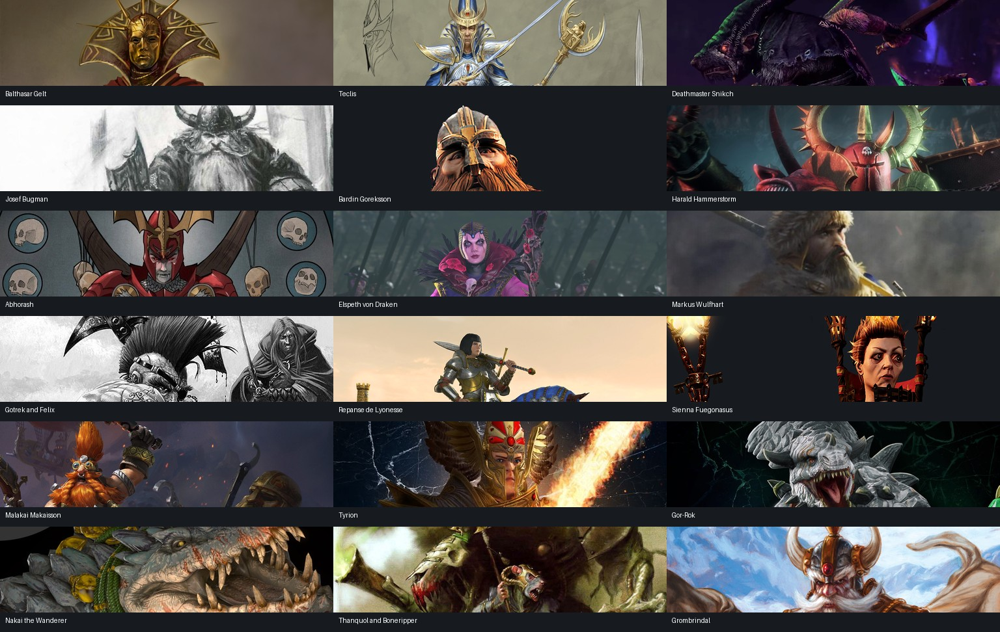

# Travelling adventurers

Implemented 21 October 2026: **18 adventurers, 360 triggered-only encounters, 18 arrival notices, 1,049 encounter response options, and 18 individual event pictures**. The approved roster, fame ratings, concepts and lore sources remain in [Adventurer Province Modifier Design.md](../Adventurer%20Province%20Modifier%20Design.md).

## Runtime behavior

- `events/War_Adventurer_Setup.txt` initializes the unique locations through the existing startup on_action. A global flag and an immediate guard prevent repeated placement. A start that is no longer owned/settled in an older save gets an eligible replacement; existing saves with the initialized flag retain their saved locations.
- Each character has a permanent, transferable province modifier named **[Name], Adventurer** (**Gotrek and Felix, Adventurers** for the pair), independent of the owner's attitude. All include **+10% province trade power** for trade-map visibility and **+2 local unrest**, plus their original +5% local benefit. For Thanquol and Boneripper, the original benefit was trade power, so that value rises from +5% to +10% rather than adding the same key twice.
- All 360 encounters are country events registered in **`on_bi_yearly_pulse_5.random_events`**, at weight **400 each**. The existing **2000 = 0** entry remains. A lone visitor with five eligible stories therefore has a 50% chance per two-year pulse. Location/asset restrictions can reduce the eligible pool; multiple visitors share the country's one random-event draw. This is a probability, not a fixed interval.
- Every event directly scopes to that character's saved global province target and requires the presence modifier, current ownership, readiness, home/abroad geography, and friendly/enemy relationship. It also checks that another eligible country exists. No MTTH or per-province random polling is used.
- The event saves its current province as a local event target. **`goto = war_adventurer_province`** and all province effects use that same location. Country effects reach the ruler receiving the report.
- All options use the same `after` movement block. Two or more distinct neighboring countries select an eligible neighbor; zero or one selects worldwide. A blocked neighbor pool also falls back worldwide. The country is chosen in `immediate`, when the report opens, so every option can say **The Adventurer departs for [Country]**. The province is chosen in `after`, when the response is resolved; no modifier moves before then. Subjects count as separate countries, and the current owner is excluded.
- **Bugman prefers eligible beer provinces inside the already-selected country.** Beer never overrides the island restriction or the one-adventurer-per-province rule, and never changes the country-selection weights.
- Movement uses the province's owner at resolution, even if ownership changed while the event was open. The displayed country is retained unless ownership, eligible destinations, or borders change while the report is open; an invalid destination is selected again under the same movement rules. The original presence is removed only after a valid destination is selected. If no destination remains, the unique character stays for a later eligible encounter.
- After a successful transfer, the destination province's owner immediately receives the character's **arrival notice**. Its title identifies the adventurer and province; two short paragraphs introduce the visitor from the ruler's perspective. Both pairs use plural wording. The single **Noted** option has no effects, and the notice neither moves the visitor nor changes the cooldown. Failed moves and initial placement send no arrival notice.
- Arrival creates a **365-day cooldown** to prevent rapid repeated hops between countries with different pulse dates. Pending events lock their province; a lock older than one year can recover if its recipient disappeared. Current encounters still recheck their own modifier before moving anyone.

## Event IDs

Each namespace below contains `.1`–`.20`: **1–5 friendly home, 6–10 friendly abroad, 11–15 enemy home, 16–20 enemy abroad**. Titles and descriptions use `.t` / `.d`; options use `.option_a` through `.option_d` so the fourth option cannot collide with the description key. Each namespace also has **`.21`**, a triggered-only arrival notice called directly by the movement effect and excluded from the pulse. Its local `war_adventurer_arrival_province` target records the destination for that report independently of later moves.

| Character | Namespace | Starting owner | Province |
|---|---|---|---:|
| Balthasar Gelt | `war_adventurer_gelt` | I22 — Iron Court | 2972 |
| Teclis | `war_adventurer_teclis` | I64 — Goa | 4182 |
| Deathmaster Snikch | `war_adventurer_snikch` | Z75 — Hojizu | 4776 |
| Josef Bugman | `war_adventurer_bugman` | I01 — Goldtooth | 2795 |
| Bardin Goreksson | `war_adventurer_bardin` | B23 — Darkhold | 4258 |
| Harald Hammerstorm | `war_adventurer_harald` | B77 — Puppets of Misrule | 2644 |
| Abhorash | `war_adventurer_abhorash` | Z09 — Numas | 851 |
| Elspeth von Draken | `war_adventurer_elspeth` | A67 — Akendorf | 872 |
| Markus Wulfhart | `war_adventurer_wulfhart` | Z16 — Copher | 988 |
| Gotrek and Felix | `war_adventurer_gotrek_felix` | A01 — Reikland | 1 |
| Repanse de Lyonesse | `war_adventurer_repanse` | A17 — Lyonesse | 284 |
| Sienna Fuegonasus | `war_adventurer_sienna` | A41 — Magritta | 553 |
| Malakai Makaisson | `war_adventurer_malakai` | A29 — Kislev | 332 |
| Tyrion | `war_adventurer_tyrion` | H08 — Avelorn | 1829 |
| Gor-Rok | `war_adventurer_gor_rok` | V03 — Itza | 2466 |
| Nakai the Wanderer | `war_adventurer_nakai` | H20 — S'sildra Tor | 2348 |
| Thanquol and Boneripper | `war_adventurer_thanquol` | U25 — Grey Seer Clan | 4600 |
| Grombrindal | `war_adventurer_grombrindal` | U37 — Clan Angrund | 4410 |

Two within-country corrections satisfy the mainland rule: **Repanse starts at Merton (284)** instead of isolated Lyonesse city (484), and **Tyrion at Phoenix Gate (1829)** instead of isolated Gaen Vale (1828).

## Geography and relationships

The `war_adventurer_mainlands` province group contains **3,024 map provinces**, derived from pixel adjacency in `map/provinces.bmp`, excluding sea/lake provinces and retaining the principal continental component (2,878 provinces), principal Ulthuan landmass (103), and principal Nippon landmass (43). The separate 373 offshore land provinces are excluded. Settled-city and ownership selection add further runtime restrictions. This is a physical-map snapshot; update `map_eligibility.json` when the map changes.

Home regions are explicit geography in `common/scripted_triggers/war_adventurer_triggers.txt`. The western mountain definition excludes the Mountains of Mourn, Darklands and Giant-Home Mountains. Dragonback Mountains (699) is impassable and cannot host a traveller. Ulthuan and Nippon are the approved principal-landmass exceptions to the no-islands rule.

Enemy profiles use **only current Alignment / Racial Administration country modifiers**. There are no religion, culture, tag or diplomatic-enemy tests in those profiles. Explicit state-necromancy incidents additionally require Undead Administration; harbour and frozen-ground reports have location filters. Those filters select an appropriate story, without redefining hostility. Every category retains unrestricted story alternatives.

The Altdorf college's old Gelt general reward is now a **Magister of the Gold Order** with unchanged stats, preventing a second scripted Gelt. This does not rename generals already created in old saves. No named ruler is killed or removed by these events.

## Writing and balance

Every encounter description has **6–10 sentences across 2–3 paragraphs**, with 2–4 sentences per paragraph. Reports tell the ruler what witnesses, officers, survivors or petitioners have learned. Every encounter and arrival notice introduces the adventurer by name and an identifying role at the first mention, so it stands alone for a reader unfamiliar with the character. Both members of each travelling pair are introduced, and references to other adventurers receive their own short identification. All 68 lore anchors are represented through the approved incident concepts; later adventures inspire incidents without forcing their canonical chronology or End Times outcomes.

The exact option effects are authored in [event_data.json](event_data.json). Every option's total Weighing Value is commented in the event script and is within ±1 of its event's +1/+2 or −1/−2 target, using [Jeff's Balance Guide](../Examples/Balance%20Guide.txt). Costs and incident losses are included in that total, not charged again elsewhere. There are **no timed country modifiers** in the response options.

Direct-effect pricing is linear: 50 monarch power, half a year's income, a year's manpower, 1 innovativeness, 2 percentage points professionalism, 2 development, or 25 prestige each correspond to +1; 25 devastation corresponds to −1 and a size-1 rebel rising to −2. Negative resource/prestige changes use the symmetric loss valuation. Positive prestige uses the guide's existing prestige-or-monarch-power helper. Integer-only effects use whole numbers.

Unpriced conceptual rewards were adapted to priced effects with matching action text: military training gives professionalism or military power; naval rescue knowledge gives diplomatic power; local reconstruction gives development; public recognition gives prestige. The passive package includes the requested +10% province trade power, the existing local benefit where different, and +2 unrest. It is **not assigned an invented valuation** because the guide does not price those exact local forms.

## Artwork

All 18 province modifiers share `picture = "war_adventurer_icon"`, using `gfx/interface/ideas_EU4/war_adventurer_icon.dds`. This follows the game's province-modifier picture lookup, as used by estuary icons. The generated sword points up and right, with a steel blade, gold fittings and a transparent background. The runtime icon is **64×64 DXT5 DDS**, preserving alpha. The individual event portraits below remain the character illustrations.

The icon was generated with the **built-in imagegen tool**. Its [source PNG](Art/war_adventurer_icon.png), [64-pixel preview](Art/war_adventurer_icon_64.png), and [complete generation prompt and asset metadata](Art/icon_generation.json) are saved with this implementation. Resizing and DDS conversion preserve the generated artwork and transparency.

[art_sources.json](art_sources.json) records the source page, original image URL, attribution, retrieval date, crop and installed asset for all 18 characters. Images are cropped/resized from the sourced illustrations or game artwork, saved as **512×132 DXT1 DDS**, and registered in `interface/war_eventpictures.gfx`. The 512×132 dimensions match the existing mod banners; the previous 320-pixel height extended over the event description. Individual crop centering keeps faces inside the shallow banner. Attribution records provenance; it does not assert a redistribution licence for third-party Warhammer artwork.



## Editing and rebuilding

`event_data.json` is the authoritative source for finished descriptions, labels and explicit numerical effects. Each character has an authored `modifier_description`; an optional `modifier_name` overrides the usual modifier title for Gotrek and Felix's plural wording. Each character's `arrival_description` supplies the four-sentence arrival introduction, while `event_introduction` records the identifying phrase required at the beginning of every report and used by the optional composition helper. Edit it, then run from the mod directory:

```bash
python3 "Dev Stuff/Adventurers/build_adventurers.py"
python3 "Dev Stuff/Adventurers/validate_adventurers.py"
```

The builder rewrites the focused adventurer files and only its marked blocks in shared on_actions/map files. `compose_localization.py` is an optional authoring helper using the original reports and `scene_details.txt`; running it deliberately replaces the finished descriptions. It is not required for normal rebuilds.

To regenerate pictures, supply a directory containing the original downloaded `CODE.img` files recorded in the manifest, then run `build_portraits.py /path/to/images` with a Python installation providing Pillow. The installed DDS files are sufficient to run the mod; original downloads are not required.

## Validation and in-game check

[validation.json](validation.json) records successful checks of event IDs, pulse registration, all localisation references and BOM, sentence/paragraph structure, option budgets and effect scopes, portrait DDS headers and sprite references, all 68 lore anchors, geography names, and 18 distinct starting owners. A restricted interpreter executes the **actual scripted movement effects** against fixtures covering borders, fallback, occupied/island/unsettled destinations, beer preference, changed ownership, destination failure, cooldowns and startup idempotence. It also checks all 512 combinations of the four hostility profiles against independent expected results. All 1,049 encounter responses are checked for exactly one arrival notice addressed to the actual destination owner. Arrival checks cover effect-free acknowledgements, exclusion from the pulse, failed-move silence, initial-placement silence, and preservation of each report's province through successive moves. Destination-preview checks verify that every encounter response uses the announced country without rerolling, while ownership/border changes and lost destinations remain safe. All portrait DDS headers must be 512×132.

EU4 scripting signatures were cross-checked with the primary [CWTools EU4 configuration](https://github.com/cwtools/cwtools-eu4-config/tree/a85622d368bbb7afca938ed70fdd5eda44aec769). This is **static validation and script simulation, not a live engine playtest**.

For an in-game check, start a fresh campaign and inspect the 18 starting modifiers. As Reikland, `event war_adventurer_gotrek_felix.1` exercises a friendly home report; its goto should point to East Altdorf, and resolving any option should transfer the unique modifier to a qualifying country. Test normal pulse behavior by allowing the campaign to run; console forcing does not itself prove pulse eligibility. When a visitor moves into a player-owned province, confirm the arrival notice names that province and has an effect-free acknowledgement. Confirm the portraits, paragraph layout, displayed effects and modifier transfer, then inspect `logs/error.log` for `war_adventurer` errors.
